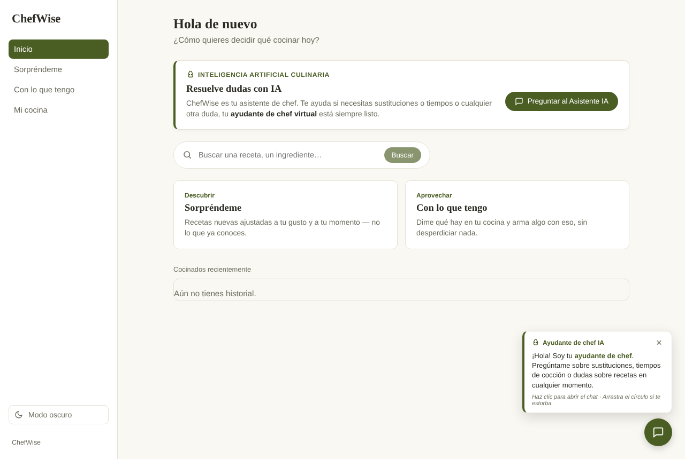
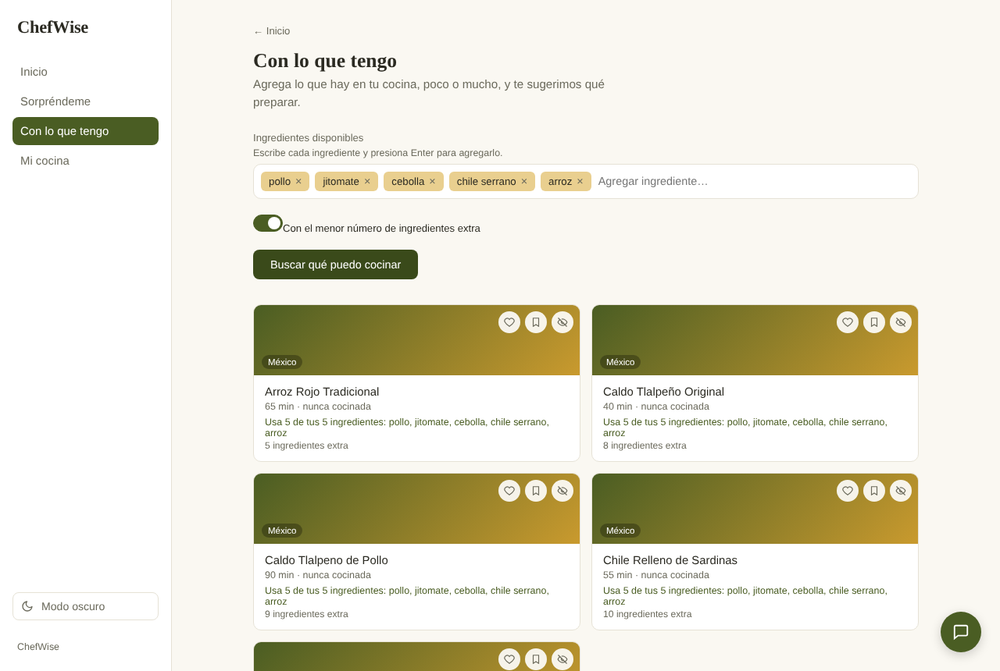
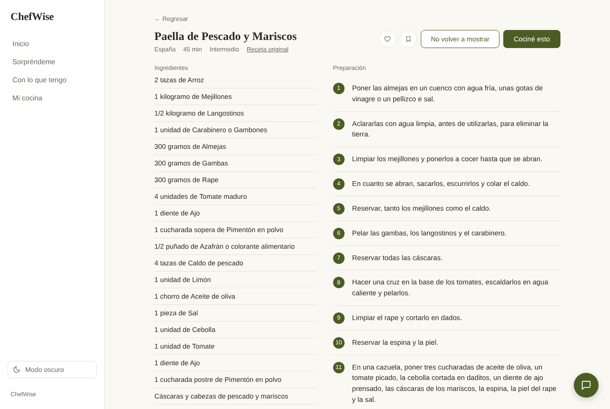

# ChefWise: a recipe recommender with an AI cooking assistant

**English** | [Español](README.es.md)

[](https://github.com/lezti02/Chefwise/actions/workflows/ci.yml)


🌐 **Live demo:** https://chef-wise-three.vercel.app (the app is in Spanish)
📄 **Written report (Spanish):** [`docs/chefwise_documentacion.pdf`](docs/chefwise_documentacion.pdf) · **Slides:** [`docs/chefwise_presentacion.pdf`](docs/chefwise_presentacion.pdf)

ChefWise answers the everyday question *"what should I cook today?"*. It recommends recipes from a catalogue of
**28,798 Spanish-language recipes** (Mexico, Spain and other countries) based on what you feel like eating or
what you already have at home, warns you about your allergies, learns from the recipes you open, save and cook,
and includes an AI assistant that helps while you cook.

Final project of the Data Science Diploma (cohort 34), built end to end: web scraping, data cleaning, EDA,
feature engineering, two recommendation models with an offline evaluation, a REST API and a web app.



## Highlights

- **Data collection and cleaning:** scraped ~9,000 recipes from Kiwilimon (Playwright + BeautifulSoup) and merged
  them with the RecetasDeLaAbuela dataset from Hugging Face. Fixed broken encodings, malformed rows, duplicates,
  mislabelled columns and brand names, and normalised times, ratings and difficulty levels.
- **Content-based recommender:** TF-IDF over name, ingredients, tags and country, ranked by cosine similarity plus
  a small Bayesian-rating quality weight. Hard filters (difficulty, time, country, allergies) are always respected
  and relaxed only when too few recipes are left.
- **Model comparison:** a sentence-transformers embedding model against the TF-IDF baseline on a frozen
  evaluation set of 320 queries, with Precision, Recall, Hit Rate and NDCG@K and paired bootstrap confidence intervals.
- **Personalisation:** a weighted taste profile (centroid of favourite, cooked, saved and viewed recipes) blended
  with the query similarity.
- **AI assistant with tools:** Gemini function calling with typed tools for scaling portions, converting units,
  ingredient substitutions, food safety (USDA FSIS) and catalogue search. Calculations are done by code, not by
  the LLM, and replies are sanitised before they reach the user.
- **Engineering:** FastAPI backend with Pydantic contracts, Angular frontend, 136 backend tests (pytest),
  40 frontend tests (Vitest), GitHub Actions CI and serverless deployment on Vercel.

## Results

**Which model recommends better?** Both models were scored on the same 320 queries (10 for each of 32 dish
types). A recommendation counts as relevant when it is the same type of dish.

| Test | Metric | TF-IDF | Embeddings | 95% CI of the difference | Verdict |
|---|---|---|---|---|---|
| A: "I liked this recipe, show me similar ones" | Precision@10 | 0.475 | **0.552** | [+0.048, +0.106] | Embeddings better |
| | NDCG@10 | 0.492 | **0.576** | [+0.056, +0.113] | Embeddings better |
| | HitRate@5 | 0.850 | **0.919** | [+0.025, +0.116] | Embeddings better |
| B: "I have these ingredients, what can I cook?" | NDCG@10 | **0.241** | 0.237 | [−0.026, +0.017] | No clear difference |
| | HitRate@5 | **0.581** | 0.531 | [−0.106, +0.006] | No clear difference |

A random recommender scores HitRate@5 = 0.05, so both models are far above chance.

**Decision.** Embeddings win when the query is a whole recipe, while TF-IDF matches literal ingredients just as
well, is 7× smaller (6 MB vs 44 MB plus a 488 MB model) and needs no deep-learning runtime. The app therefore
uses **TF-IDF for "With what I have" and search**, and **embeddings for "Surprise me" when they are available**,
falling back to TF-IDF in the serverless deployment. Details in
[`notebooks/05_comparacion_baseline_vs_embeddings.ipynb`](notebooks/05_comparacion_baseline_vs_embeddings.ipynb).

## The app

| Section | What it does |
|---|---|
| **Sorpréndeme** (Surprise me) | Pick categories, difficulty, country and available time; get recipes you have not tried yet. |
| **Con lo que tengo** (With what I have) | Type the ingredients in your kitchen; recipes are ranked by how many of them they use, optionally with the fewest extra ingredients first. |
| **Search** | Search the whole catalogue by recipe name or ingredient. |
| **Recipe** | Ingredients, one-instruction steps, an allergy warning and a "I cooked this" button. |
| **Mi cocina** (My kitchen) | Monthly summary, history, favourites, saved recipes, allergies and ingredients to avoid. |
| **Assistant** | Floating chat that answers questions about the recipe on screen. It never invents recipes or nutrition values. |





## Architecture

```
Angular (frontend/) ──HTTP──▶ FastAPI (backend/) ──▶ src/ (recommender)
                                   │                    ├─ data/processed/*.csv    recipes
                                   │                    └─ models/recetas_modelo/  trained TF-IDF and embeddings
                                   └──▶ Gemini (assistant only, with tools in backend/assistant/)
```

User data (favourites, history, allergies) lives in the browser's `localStorage`; there are no accounts or database.

## Repository structure

| Path | Contents |
|---|---|
| `notebooks/` | 01 initial EDA and cleaning · 02 EDA and feature engineering · 03 TF-IDF recommender · 04 embeddings recommender · 05 model comparison · 06 K-Means clustering |
| `src/` | Recommender package: data loading, filters, ranking, personalisation profile, embeddings and evaluation metrics. |
| `src/web_scraping/` | Kiwilimon scraper (`lista.py` collects URLs from the sitemap, `recetas.py` downloads each recipe). |
| `backend/` | FastAPI app (`main.py`, `routes.py`, `schemas.py`, `settings.py`) and the AI assistant (`assistant/`). |
| `frontend/` | Angular app. |
| `api/index.py` | Vercel serverless entry point (serves `backend/` under `/api`). |
| `data/processed/` | Clean recipes (`recetas_limpias.csv`) and model features (`recetas_modelo.csv`). |
| `data/evaluation/` | Frozen evaluation set and comparison results. |
| `models/recetas_modelo/` | Trained TF-IDF vectoriser and matrix, recipe embeddings. |
| `tests/` | Backend tests against the real data and models. |
| `docs/` | Written report, slides, strategy document and screenshots. |

## Run locally

Requires Python 3.13 and Node 24+. From the repository root:

```bash
# 1. Backend → http://localhost:8000 (interactive docs at /docs)
python3 -m venv .venv && source .venv/bin/activate
pip install -r requirements.txt
uvicorn backend.main:app --reload

# 2. Frontend → http://localhost:4200 (in another terminal)
cd frontend && npm install && npm start
```

The assistant needs a free Gemini key: copy `.env.example` to `.env` and paste your key from
[Google AI Studio](https://aistudio.google.com/apikey). Without it the chat returns 503 and everything else works.

To rerun the notebooks, the embeddings experiment or the scraper, install `requirements-dev.txt`. The raw data
is not in the repository; see the Spanish README for how to regenerate it.

## Tests

```bash
python -m pytest -q                               # backend
cd frontend && npm test -- --watch=false          # frontend
```

## API

| Method and path | Description |
|---|---|
| `GET /health` | Health check. |
| `POST /recommendations` | "Surprise me": top N for the chosen tags, difficulty, time and country. |
| `POST /recommendations/by-ingredients` | "With what I have": similarity with the typed ingredients. |
| `GET /recipes/{recipe_id}` | Full recipe (404 if it does not exist). |
| `POST /chat` | AI assistant about the recipes on screen. |

## Author

**Itzel Guadalupe Camacho Gómez** · [GitHub](https://github.com/lezti02)
